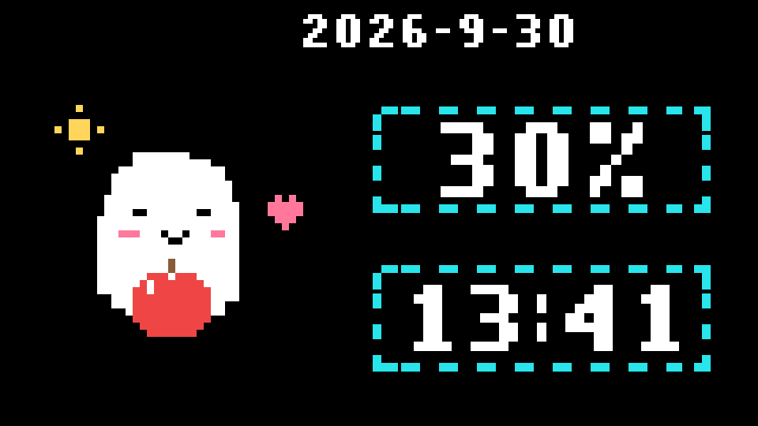

# Codex Ghost 👻 · Codex 小幽灵

**A quiet pixel companion for your Mac — a tiny ghost, your Codex quota, and the time.**

Black background. Crisp pixels. A fat red apple, a softly beating pink heart, and a little sun with rotating rays. Thick cyan dash-dot frames drift quietly clockwise around the numbers. Made to sit quietly on a small desk display.



*This animation uses synthetic 30% quota and a fixed example date/time. It is not a live account reading.*

## What it does

- Shows **Codex weekly remaining quota**, local date, and local time. The percentage is `100 − usedPercent`, rounded down; it is **not task progress**.
- The ghost hugs an apple below 50%, floats at 50–79%, carries a red flag at 80–99%, and waves with a star at 100%.
- Day and night have separate expressions/accessories. The apple pose alternates between smiling and a little kiss; the heart gently beats. The night moon stays still.
- Both cyan frames move together around a closed pixel perimeter. The numbers remain stationary; reduced motion also freezes the frames.
- Uses native **AppKit + WKWebView** with bundled SVG. No Electron, Python, Node, or local web server is needed **to run the built app**.
- Reads quota through the locally installed official Codex CLI and its existing login. No model prompts or conversations are sent by this app. Authentication stays with the official CLI.
- Single instance, 60-second refresh, and an explicit unknown `--%` state. A recent successful value is kept for at most 120 seconds, never past its quota reset time.
- Honors reduced motion. No glow, gradients, sounds, or background notifications.

## Build on a Mac

Current target: **Apple Silicon, macOS 14+**. Actual device verification: arm64, macOS 26.7. Intel and other macOS versions have not been tested.

Install Xcode Command Line Tools if you do not already have them, then:

```bash
git clone https://github.com/freesir102/codex-ghost.git
cd codex-ghost
bash build-app.sh
```

In Finder, open `build` and double-click **Codex 小幽灵.app**. You may copy it to Applications. The build includes an ad-hoc signature; no notarized public installer is provided.

The build script protects an existing build from accidental overwrite. Preserve or move your previous build before rebuilding.

For live quota, keep an official Codex installation and an authenticated account available. The app checks common official app/Homebrew/local CLI locations. The CLI must support `app-server` and `account/rateLimits/read`. If it cannot read a valid weekly window, it shows `--%`; it does not invent a percentage or change your login. The app-server interface may change, so future official CLI updates can require adaptation.

**Controls:** ⌘R refresh · ⌘F full screen · ⌘Q quit. The app menu can preview all eight synthetic animation states and then returns to real quota. Double-clicking a running app brings its existing window back, including after minimizing.

If a display name contains `Wokyis`, the app places itself there and enters native full screen. Otherwise it opens a normal window that you can move to your preferred display. Full screen auto-hides the menu bar and Dock.

You can also open `index.html` directly to preview the design with synthetic data; the browser preview does not read Codex quota.

## Development & checks

```bash
npm test                 # actual SVG/render callback and state checks; no dependencies
bash tests/quota.sh       # Swift quota parser, synthetic positive/negative inputs
bash build-app.sh         # native build, bundle and signature validation
```

Node is needed only for development checks/assets, not the native app. To regenerate the synthetic preview or icon assets:

```bash
npm ci
npm run preview
node build-icon.cjs
iconutil -c icns build/AppIcon.iconset -o native/AppIcon.icns
```

[Verification and current limits](docs/VERIFICATION.md) · [All eight day/night states](docs/states.png)

## Local data

The app keeps a small bounded diagnostic history and optional validation snapshots under `~/Library/Application Support/CodexPixelCompanion/`. It does not export them. Runtime logs, account responses, user data, build archives, and personal screenshots are excluded from this repository. No API key is required by the app.

This is an independent community project, not an official OpenAI application.

---

## 中文

**在小屏幕上安静陪伴你的 Codex 小幽灵。** 黑底、白色像素、青色长线段与圆点边框，只显示日期、每周剩余额度和时间。

- 低于50%抱胖红苹果；50–79%轻轻漂浮；80–99%举红旗；100%挥手和星星。
- 苹果没有绿叶、特意画出的小手或热气；微笑和撅嘴交替。粉心轻轻跳动，太阳四条光线沿像素格转圈。
- 两个较粗的青色边框同步顺时针流动，转角连续绕行，框内数字不动；开启减少动态效果时全部静止。
- 本机编译成真正的 Mac App，运行无需终端或 Node/Python；真实额度依赖已登录的官方 Codex CLI与联网状态。
- `bash build-app.sh` 构建后，从 Finder 双击 `build` 中的 **Codex 小幽灵.app**。⌘R刷新、⌘F全屏、⌘Q退出。
- 百分比代表**每周剩余额度**，不是任务完成率。无法读取时显示 `--%`。顶部演示动画是合成示例，不是个人账号数据。

欢迎通过 Issues 提出小屏适配或使用问题，通过 Pull Request 提交改进。如果这个小幽灵也适合你的桌面，欢迎点一个 **Star ⭐**。

## License

[MIT](LICENSE) — Copyright © 2026 Jing Yan (freesir102).
